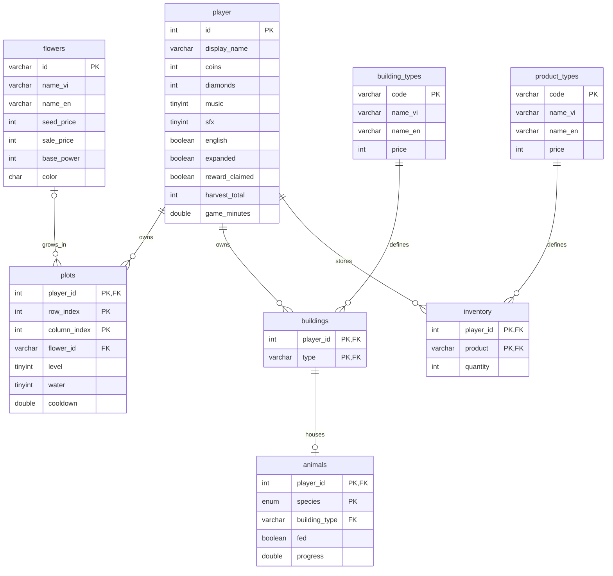
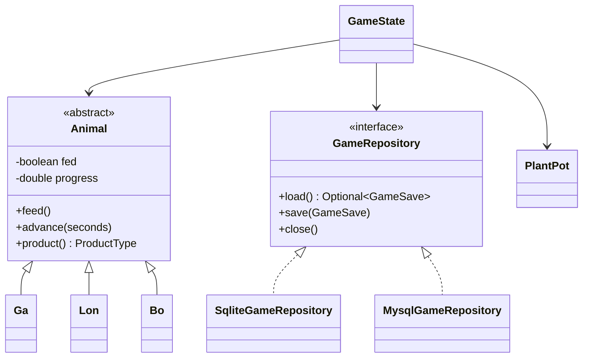

# Cloud Garden — thiết kế MySQL đề xuất

Đây là thiết kế cho bước chuyển từ SQLite sang MySQL. Các file mẫu chưa được tích hợp vào ứng dụng trên ổ D. Bản hiện tại vẫn dùng SqliteGameRepository.

## ERD

PK là khóa chính, FK là khóa ngoại. Một khóa chính có nhiều cột là khóa chính ghép, không phải nhiều khóa chính độc lập.

- Mỗi ô trồng thuộc đúng một người chơi, có thể không có hoa hoặc có một loại hoa. Một loại hoa có thể xuất hiện ở nhiều ô.
- buildings nối player với building_types: một người chơi sở hữu nhiều loại công trình; một loại công trình được nhiều người chơi sở hữu. Demo mỗi người sở hữu tối đa một công trình mỗi loại.
- animals tham chiếu cặp (player_id, building_type) của buildings: vật nuôi bắt buộc ở công trình người chơi đã sở hữu. CHECK buộc gà/chuồng gà, lợn/bãi bùn, bò/chuồng bò đúng loại. Với khóa chính và CHECK hiện tại, mỗi công trình chứa tối đa một vật nuôi trong demo.
- Khóa (player_id,species) cho phép tối đa một gà, một lợn, một bò mỗi người chơi, khớp demo Java hiện có.
- inventory nối player với product_types, lưu số lượng từng sản phẩm của từng người chơi.
- Sản phẩm con vật tạo ra do Animal.product() của Ga/Lon/Bo quyết định. ERD không vẽ một đường animals → product_types vì schema không có khóa ngoại đó.
- Schema cho phép nhiều dòng player. Ứng dụng hiện vẫn một nông trại, chưa có tài khoản/đăng nhập. Schema nhiều người không tự tạo chức năng multiplayer.

## OOP: sơ đồ lớp khác ERD

MysqlGameRepository là lớp cần viết tiếp, chưa có trong chương trình hiện tại. Ga/Lon/Bo cùng lưu vào bảng animals; đọc species rồi gọi Animal.create(species) để phục hồi đúng lớp Java. Không cần ba bảng chỉ vì có ba lớp con.

## Cách dùng các file

1. Máy đang có MySQL Server 8.0.46 và Workbench 8.0; dùng bản này. Nếu cài máy khác, lấy MySQL Community Server và Workbench từ dev.mysql.com. Schema yêu cầu MySQL 8.0.16 trở lên (hỗ trợ CHECK).
2. Nếu server chưa được cấu hình, đặt mật khẩu root, cổng 3306, chạy Windows Service. Kiểm tra Test Connection trong Workbench để biết server đang chạy; hướng dẫn này chưa đăng nhập hoặc tạo schema trên server thật.
3. Trong Workbench kết nối localhost:3306, dùng root để tạo schema.
4. File → Open SQL Script, mở mysql-schema.sql, thực thi toàn bộ.
5. Với database mới, mở mysql-seed.sql và thực thi một lần. Nếu một câu INSERT bị lỗi thì chạy ROLLBACK và sửa trước khi chạy lại, không tiếp tục COMMIT phần còn lại.
6. Refresh Schemas, mở cloud_garden → Tables, kiểm tra đủ 8 bảng.
7. Database → Reverse Engineer → chọn connection → chọn cloud_garden → chọn các bảng và đặt lên diagram → Finish.
8. File → Save để lưu cloud-garden.mwb. Khi tab diagram mở, File → Export để xuất PNG/PDF cho báo cáo.

## Nối với Java

1. Thêm mysql-connector-j JAR vào lib. run.ps1 hiện đã dùng out;lib\* khi chạy nên driver sẽ nằm trên classpath.
2. Viết MysqlGameRepository implements GameRepository, load()/save()/close(). Demo dùng player_id=1 như bản hiện tại.
3. URL JDBC là jdbc:mysql://localhost:3306/cloud_garden; lấy user/password từ biến môi trường, không lưu password trong Git.
4. save() phải dùng PreparedStatement và transaction: setAutoCommit(false), khóa player tương ứng nếu có nhiều tiến trình cùng ghi, cập nhật player/plots/buildings/animals/inventory, commit; catch thì rollback.
5. Nếu giữ chiến lược xóa rồi ghi lại snapshot, phải DELETE animals trước buildings vì animals có FK đến buildings. INSERT buildings trước animals. Không xóa các bảng danh mục khi lưu game.
6. Viết truy vấn đọc flowers, building_types, product_types thành các đối tượng/cấu trúc danh mục Java. Dùng giá từ danh mục đó trong Service thay cho giá hardcode cũ; không để database và Java có hai bộ giá khác nhau.
7. Main khởi tạo MysqlGameRepository rồi truyền vào GameState. Không chỉ đổi JDBC URL của SqliteGameRepository: PRAGMA, schema và cú pháp upsert SQLite không dùng nguyên xi cho MySQL.
8. Nếu cần giữ save cũ, viết bước import GameSave từ SQLite sang MySQL một lần, hoặc yêu cầu người dùng chọn rõ chuyển save hay tạo mới. Không gọi import Preferences cũ tự động cho MySQL nếu muốn giữ save SQLite mới nhất.
9. Kiểm tra thu hoạch chỉ cộng coin một lần, lưu lỗi phải rollback, khởi động lại vẫn giữ tiền/cấp hoa/vật nuôi/sản phẩm/cài đặt; thử FK chặn vật nuôi trong công trình chưa sở hữu.

Luồng ứng dụng: frontend → GameController → GameService/GameState → Entity → GameRepository → MySQL. Frontend chỉ gọi API Java, không kết nối trực tiếp database.

## Nguồn chính thức

- Server: https://dev.mysql.com/downloads/mysql/
- Cài Windows: https://dev.mysql.com/doc/refman/8.4/en/windows-installation.html
- Workbench: https://dev.mysql.com/downloads/workbench/
- Connector/J: https://dev.mysql.com/downloads/connector/j/
- JDBC URL: https://dev.mysql.com/doc/connector-j/en/connector-j-reference-jdbc-url-format.html
- Reverse Engineer: https://dev.mysql.com/doc/workbench/en/wb-reverse-engineer-live.html
- Export diagram: https://dev.mysql.com/doc/workbench/en/wb-data-modeling-menus.html
